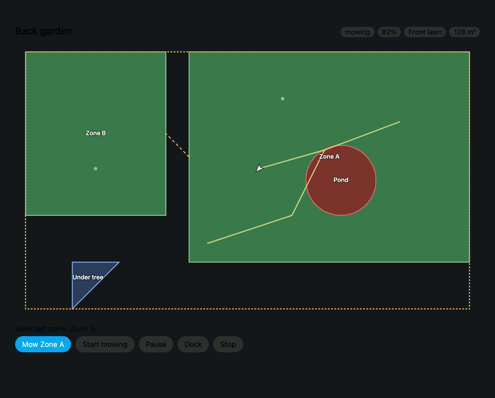

# Dreame Robot for Home Assistant

A community Home Assistant custom integration for **Dreame** and **MOVA** robotic
lawn mowers, with an **interactive map**.

Unlike a vacuum integration, a mower needs a map you can actually read: which
lawn is loaded, where the zones are, where the mower is right now, and a way to
send it to any of them. This gives you all four — a live SVG map you can tap,
per-zone mowing, live position, and the full control surface Home Assistant's
`lawn_mower` domain expects.



## Documentation

| Document | What is in it |
| --- | --- |
| **[Installation](docs/installation.md)** | Install via HACS or manually, set up the card, regions, every option, and a troubleshooting table |
| **[Cards](docs/cards.md)** | Card options and complete YAML dashboards |
| **[Entities and services](docs/entities.md)** | Every entity, attribute and service, plus example automations |
| **[Maps](docs/maps.md)** | The map subsystem end to end, from wire format to pixels |
| **[Protocol](docs/protocol.md)** | The reverse-engineered cloud and MQTT protocol in detail |
| **[Contributing](CONTRIBUTING.md)** | Development setup, and how to add a model |

## Features

- **Interactive map card** — tap a lawn zone, a spot area, a map edge or a bare
  spot on the map and send the mower there. Live position, heading and travel
  trail.
- **Standard entities** — `lawn_mower`, `image` (PNG map), `sensor`,
  `binary_sensor`, `switch`, `number`, `select`, `button`, `update`. 39 entities
  enabled by default.
- **Targeted mowing** — all-area, per-zone, spot areas, map edges, ad-hoc
  patches, and drive-to-point.
- **Live updates over MQTT** — battery, state and position arrive as push
  messages; polling is only a fallback.
- **Settings** — rain protection, charging window, voice volume and the four
  voice prompt groups.
- **Diagnostics** — maintenance counters, device-code errors with severity, task
  progress, firmware updates.

## Quick start

1. Install **Dreame Robot** from HACS, or clone `https://github.com/forming/homeassistant-dreame-lawn-mower`
   and copy `custom_components/dreame_robot` into your config directory. See
   [Installation](docs/installation.md).
2. Restart Home Assistant.
3. **Settings → Devices & Services → Add Integration → Dreame Robot.** Sign in
   with your Dreamehome or MOVAhome account.
4. Copy the card to `config/www/` and register it as a Lovelace resource — see
   [Set up the map card](docs/installation.md#set-up-the-map-card).
5. Add to a view:

   ```yaml
   type: custom:dreame-robot-map
   entity: lawn_mower.back_garden
   ```

The mower needs to have completed a mapping run in the vendor app first;
otherwise there is no map to draw.

## Requirements

- Home Assistant 2024.12 or newer
- A Dreamehome or MOVAhome account with a mower bound to it
- The mower must have completed at least one mapping run

Outbound HTTPS on 443, plus outbound TCP 8883 for live updates.

## Supported models

Anything the cloud reports with `.mower.` in its model id is accepted. Confirmed
working:

| Model | Name | Notes |
| --- | --- | --- |
| `dreame.mower.g2408` | Dreame A2 | Primary development target |
| `dreame.mower.q2501a` | Dreame A3 AWD 1000 | |
| `dreame.mower.g2568d` | Dreame A2 3000 | |
| `dreame.mower.g2541e` | Dreame A3 AWD Pro 3500 | |
| `dreame.mower.g2540d` | Dreame A1 Pro 2000 | |
| `dreame.mower.p2255` | Dreame A1 | State and commands; no map |
| `dreame.mower.g2422` | Dreame A1 Pro | State and commands; no map |
| `mova.mower.g2583` | VIAX 500 | Firmware reuses state codes 15/16/19; handled |
| `mova.mower.g2420a`, `mova.mower.g2552` | VIAX 250 | |
| `mova.mower.g2420b` | VIAX 300 | |
| `mova.mower.g2529b` | LiDAX Ultra 800 | |
| `mova.mower.g2529c` | LiDAX Ultra 1000 | |
| `mova.mower.g2529f` | LiDAX Ultra 2000 | |
| `mova.mower.g2584a` | LiDAX Ultra 2000 AWD | |

If your model is missing, open an issue with the `model` id from
**Settings → Devices & Services → Dreame Robot → the device**.

## Not supported

Stated plainly rather than half-built. Details in
[protocol.md → Limitations](docs/protocol.md#limitations).

| Not supported | Why |
| --- | --- |
| **Live video** | The vendor streams over a proprietary peer-to-peer transport that needs a native helper binary |
| **Cutting-height adjustment** | The write path is an encoded preference blob this project does not decode |
| **Schedule editing** | Reads work, but a malformed write could corrupt a schedule you depend on |
| **Legacy A1 binary map** | A grid format behind AES-CBC and zlib. Those mowers get state, battery and commands, but no map |
| **Two-factor accounts** | There is no 2FA flow to complete |
| **LAN-only control** | Everything goes through the vendor cloud |

No entity is created for a setting the device did not report, so nothing appears
to work and then fails when you use it.

## How it works

Dreame mowers speak an undocumented JSON-over-HTTPS and JSON-over-MQTT(TLS)
protocol. The client lives in `custom_components/dreame_robot/client/` and has no
Home Assistant imports, so it can be tested and reused on its own.

| Module | Responsibility |
| --- | --- |
| `cloud.py` | Login, device discovery, the `sendCommand` envelope |
| `mqtt.py` | Subscribe-only push channel for live telemetry |
| `device.py` | Polling, mowing commands, settings, map access |
| `models.py` | State and device-code tables, map parsing, binary frame decoding |
| `render.py` | The PNG renderer and the projection the map card inverts |

Three decisions shaped the code. Each is documented where it matters, so they
survive edits:

- **Mutations are never retried.** A duplicated write can apply twice on the
  device — mowing a zone twice, zeroing a counter twice. Reads retry; writes and
  actions do not.
- **A `401` is always safe to retry**, because it proves the command never
  reached the device.
- **Unknown means unknown.** An unrecognised device code is named, not guessed.
  An unrecognised state falls back to idle. The protocol is undocumented and the
  firmware changes; anything that fabricates meaning will eventually be wrong in a
  way that is hard to notice.

[docs/protocol.md](docs/protocol.md) covers all of it in detail.

## Development

```bash
uv venv --python 3.13
uv pip install -r requirements-test.txt
uv run ruff check .
uv run ruff format .
uv run pytest
```

152 tests: the protocol client standalone, the Home Assistant layer through
`pytest-homeassistant-custom-component`, and a set that keeps these docs from
drifting out of sync with the code they describe.

## Contributing

Issues and pull requests are welcome — see [CONTRIBUTING.md](CONTRIBUTING.md). If
a model does not fully work for you, please include its `model` id, its firmware
version, a diagnostics download, and what you expected to happen. Never include
your account password or access token.

## License

MIT. See [LICENSE](LICENSE).

This project is not affiliated with, endorsed by, or supported by Dreame or MOVA.
